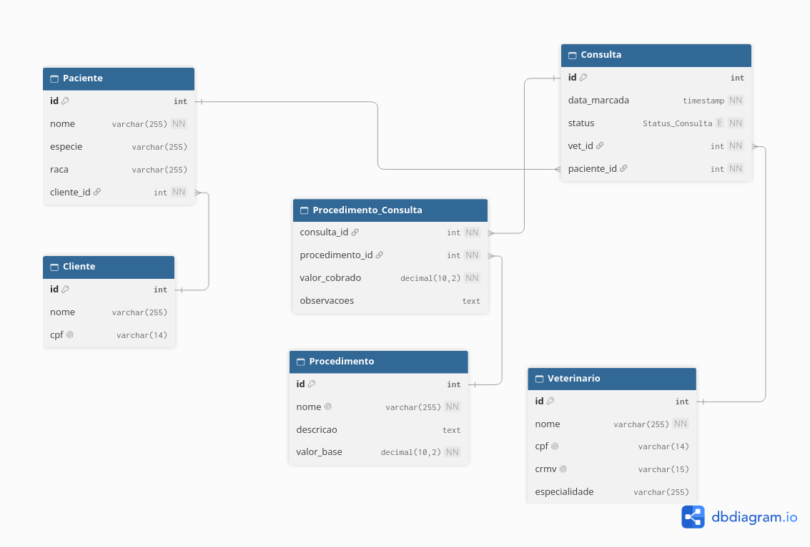

# lab_dados_trab_1
Solução para o trabalho 01 da disciplina MATB09 - Laboratório de Banco de Dados

## Contexto
Esse repositório implementa um banco de dados para uma clínica veterinária.

## Objetivos
- Cadastrar informações
- Registrar operações
- Relacionar entidades
- Responder a perguntas relevantes para a gestão

## Diagrama

## Perguntas de negócio
1. 